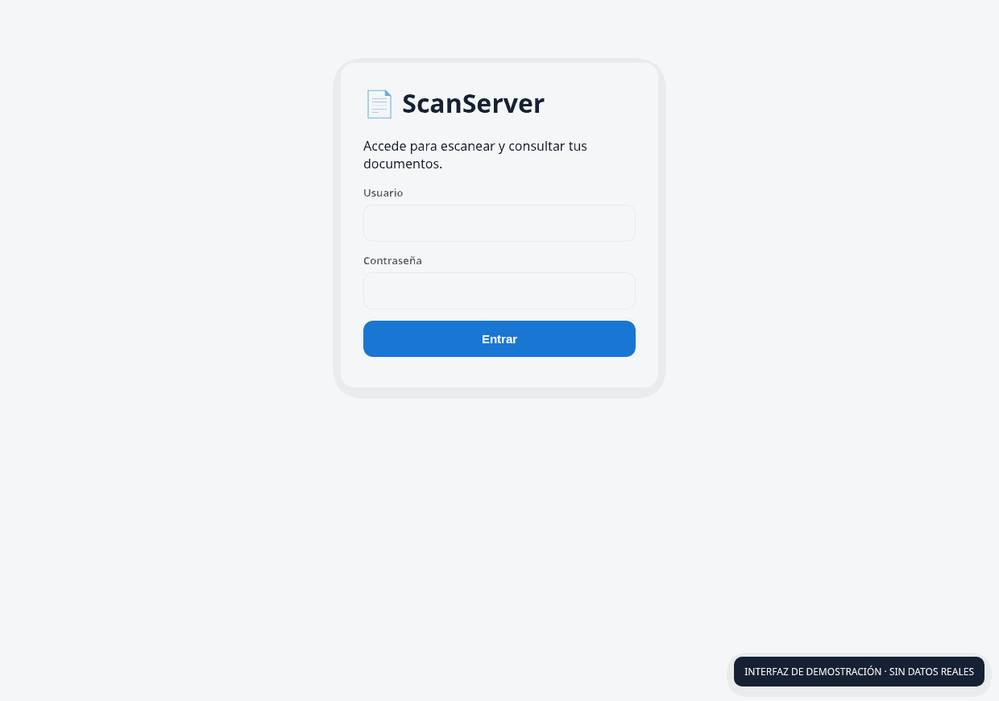
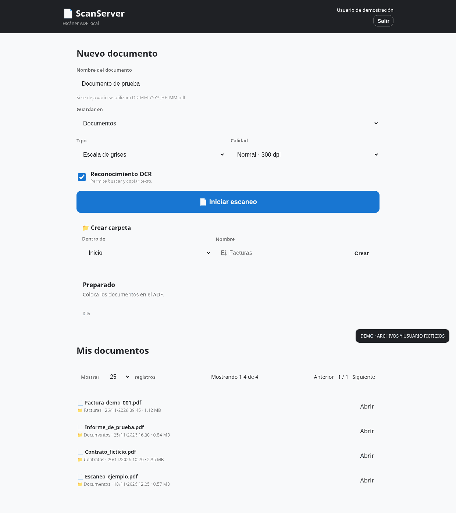

# ScanServer

**ScanServer** is a self-hosted local-network document scanning web application for an eSCL/SANE scanner with an automatic document feeder (ADF). It provides user accounts, per-user folders, PDF creation, optional OCR and a browser interface suitable for desktop and mobile.

**Initial baseline:** `v0.1.0` · **Scope:** LAN only · **Maturity:** source snapshot; installation requires manual prerequisites and a Samba helper.

> Public GitHub repository ≠ public web service. Do **not** expose the scanner, SMB, or the ScanServer API directly to the Internet.

## Interface preview (fictional data)





The screenshots were rendered from the actual shipped HTML/CSS with fictional example data, **not** captured from a user's live server.

## Highlights

- User login with Argon2 password hashes and signed session cookies.
- Private storage in per-user folders and authenticated PDF retrieval.
- ADF scanning with multiple batches per document and feeder-status checks via eSCL.
- Grayscale/color modes and 200/300/600 DPI controls.
- PDF generation, optional searchable OCR through OCRmyPDF and Tesseract.
- Manual two-pass duplex scanning, with backside reversal and page interleaving.
- Admin user creation, disabling and password changes, integrated with an external Samba user helper.
- Compact PDF history with 10, 25, 50 or 100 rows per page (UI pagination only).
- Mobile-friendly web interface.

## Architecture

```text
Desktop / mobile (trusted LAN)
          │ HTTP :8080 (private only)
          ▼
      FastAPI UI/API
       │       │
       │       ├── Argon2, session cookies, users in SQLite
       │       └── per-user PDF folders ↔ local SMB share
       ▼
  SANE / sane-airscan ── eSCL ── ADF scanner (LAN)
       │
       └── img2pdf → optional OCRmyPDF/Tesseract → PDF
```

## Requirements

- Linux host or LXC with SANE, `sane-airscan` and accessible scanner.
- Python web dependencies in [requirements.txt](requirements.txt).
- `img2pdf`, OCRmyPDF, Tesseract, Spanish OCR language data and `curl`.
- An **existing** Samba user-management helper at `/usr/local/sbin/scanserver-smb-user` for administration of users. This helper is not included in the source archive; do not assume admin account creation will work until provisioned.
- Writable `/opt/scanserver/data`, `/srv/scans/usuarios`, `/srv/scans/sessions` and appropriate system users/permissions.
- A random `SCANSERVER_SECRET`, and environment-specific scanner SANE device/status URL.

Follow [installation and migration notes](docs/INSTALLATION.md) before running the application. For Windows-assisted publication to an empty repository, see `PUBLICAR_EN_GITHUB.cmd` / `PUBLICAR_EN_GITHUB.ps1` (requires Git and GitHub CLI and an interactive GitHub login).

## Quick configuration overview

The scanner ID and endpoint must be set for **your own** device:

```sh
scanimage -L
python3 -c 'import secrets; print(secrets.token_urlsafe(48))'
```

Set `SCANSERVER_SECRET`, `SCANSERVER_SANE_DEVICE`, and `SCANSERVER_SCANNER_STATUS_URL` outside the repository. Use the template in [.env.example](.env.example).

Run only on a private network. The source can be started via Uvicorn **after** provisioning permissions and the Samba helper; see the full manual.

## Repository layout

| Path | Purpose |
|---|---|
| `web/app.py` | FastAPI routes, user management and scan orchestration |
| `web/static/` | Web UI, including history and duplex controls |
| `scan_batch.sh` | ADF scanning and feeder-status handling |
| `finalize.sh` | PDF generation, manual duplex ordering and OCR |
| `scan.sh` | Legacy standalone scanning helper |
| `ocr_progress.py` | OCR progress plugin |
| `docs/` | Deployment, security notes, screenshots and roadmap |
| `tests/` | Static regression and source-safety checks |

## Versions and contributions

- `main`: stable source snapshot.
- `develop`: future development branch (create after initial import).
- `feature/<name>`: new changes, reviewed via pull requests.
- Git tags: `v0.1.0`, `v0.1.1`, etc. after a tested release.
- Every release updates `VERSION` and `CHANGELOG.md`.

See [CHANGELOG.md](CHANGELOG.md) and [roadmap](docs/ROADMAP.md).

## Security and privacy

- No real credentials or real user documents belong in this repository.
- The session secret is mandatory; there is no insecure default.
- User documents are not intended for public sharing.
- Security work still pending is declared explicitly in [SECURITY.md](SECURITY.md) and [audit notes](docs/SECURITY_AUDIT.md).

## License

No open-source license has been selected for this initial package. Choose a license before publishing the repository if you wish to grant copying and redistribution rights. Do not copy the LICENSE from another user's fork without checking attribution.
